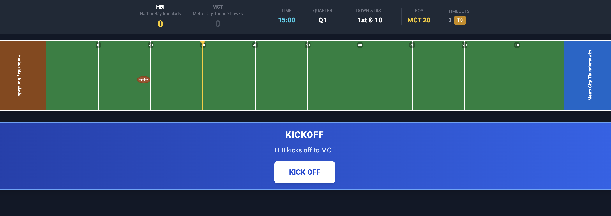

# Paydirt Football Board Game Simulation

A Python implementation of the classic Paydirt football board game, originally published by Avalon Hill.
Call the plays, manage the clock, and take on a computer opponent in your browser or terminal.



## Features

- Chart-and-dice play resolution, penalties, and special teams.
- Three CPU difficulty levels, with player coaching in Easy mode.
- Season-specific conversion and overtime rules.
- Persistent games, season schedules, standings and team statistics, with portable export/import.
- Support for your own team charts and seasons.

## Play in Your Browser

[Play Paydirt](https://rtulloh.github.io/paydirt/) in your desktop browser without
installing it. Browser play is the primary way to play. It includes **1977, 1983 and 2024**, plus the
fictional **2026 Thunderhawks and Ironclads**: 90 teams in total. Allow time for
the initial Python download; internet access is required to load the engine.
Games and seasons save locally in the same browser profile and site, and survive
ordinary reloads and browser restarts. Use **Saved games → Export** or
**Seasons → Export season** to keep portable backups. Clearing site data or using
another browser or device does not carry those local saves with you; there is no
cloud sync or guaranteed offline play.

See the [browser guide](docs/web-interface.md) for controls and the
[saving guide](docs/saved-games-and-standings.md) for storage and recovery details.

## Optional Desktop Downloads

If you prefer an installed application, downloads are available from
[GitHub Releases](https://github.com/rtulloh/paydirt/releases):

| Platform | Download |
|----------|----------|
| macOS, Apple Silicon | `Paydirt-X.X.X-arm64.dmg` |
| macOS, Intel | `Paydirt-X.X.X-x86_64.dmg` |
| Windows | `PaydirtSetup.exe` or portable `paydirt.exe` |
| Linux | `Paydirt-x86_64.AppImage` |

Launch the application to open the browser interface. Select **New Game**, choose your teams and
which side to control, then follow the coin toss and play-selection prompts.

The macOS app is ad-hoc signed, not Developer ID signed or notarized; Gatekeeper
can block a fresh download. Browser play requires no desktop installation or
macOS security override. See [installation and troubleshooting](docs/installation.md).

## Play the CLI from Source

Requires **Python 3.10+**. From a repository checkout:

```sh
git clone https://github.com/rtulloh/paydirt.git
cd paydirt
python3 -m venv .venv
source .venv/bin/activate
python -m pip install pyyaml
python -m paydirt --play --compact
```

On Windows, activate the environment with `.venv\Scripts\Activate.ps1` in PowerShell.
Use `-d easy` for coaching, or `-d hard` for a more aggressive opponent.
Use `python -m paydirt --help` to see available commands.

The browser interface needs additional dependencies and a frontend build when running from source;
see [web development setup](paydirt-web/README.md).

## Teams and Seasons

The browser edition and current desktop downloads include generated **1977**, **1983**, and **2024** season charts plus the fictional
**2026 Thunderhawks and Ironclads** sample. The historical chart sets are independent
statistical reconstructions produced by this project; see the
[chart attribution](CHART_ATTRIBUTION.md) for sources and licensing.

[Add seasons and configure rules](docs/seasons.md), or use the
[chart generator / Excel importer](docs/chart-generator.md) to convert existing `.xls` charts into CSV files.

## Documentation

Start at the [documentation index](docs/README.md), or jump to a topic:

| For players | For contributors |
|-------------|------------------|
| [Browser walkthrough](docs/web-interface.md) | [Development, testing, and packaging](docs/development.md) |
| [CLI controls, rules, and strategy](docs/playing.md) | [Web development setup](paydirt-web/README.md) |
| [Clock management](docs/clock-management.md) | [AI play-testing notes](docs/dev-notes/ai-playtesting.md) |
| [AI difficulty and coaching](docs/ai-difficulty.md) | [Replay debugging design notes](docs/dev-notes/replayable-game-logs.md) |
| [Saved games and standings](docs/saved-games-and-standings.md) | [Release notes](RELEASE_NOTES.md) |
| [Seasons and chart files](docs/seasons.md) | [Contributor/agent instructions](AGENTS.md) |
| [Chart generator tool](docs/chart-generator.md) | [Full-game browser regression](paydirt-web/frontend/e2e/README.md) |

The app's **User Guide** includes the player guides for offline reading.

## License

This is a fan-made implementation for educational purposes. Paydirt is a trademark of its respective owners.
