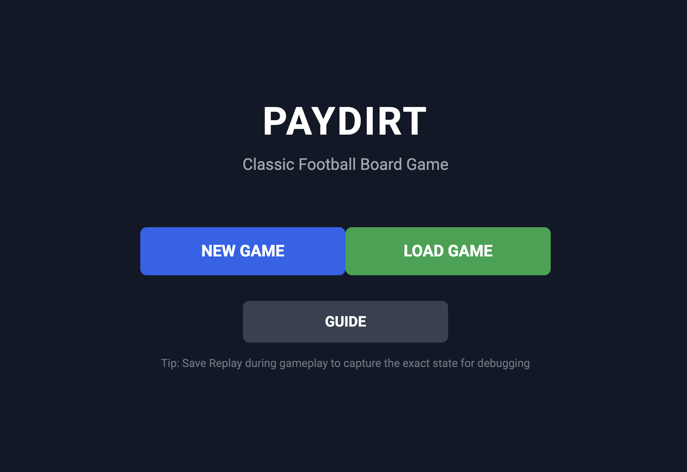
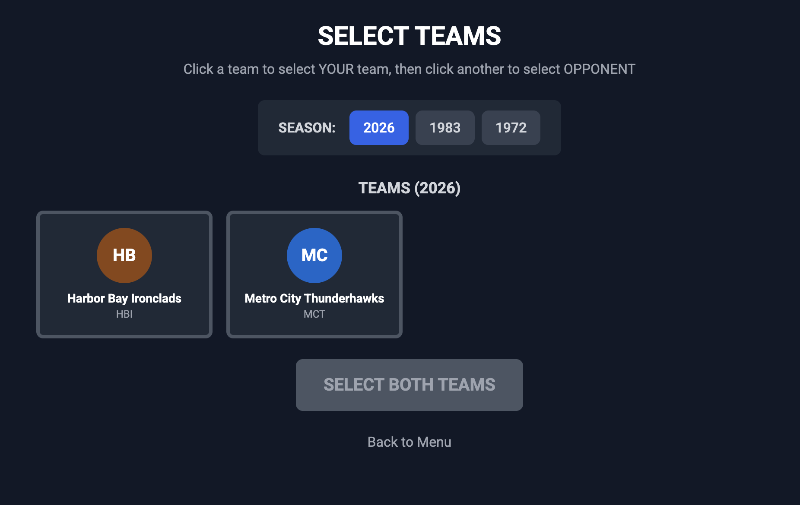
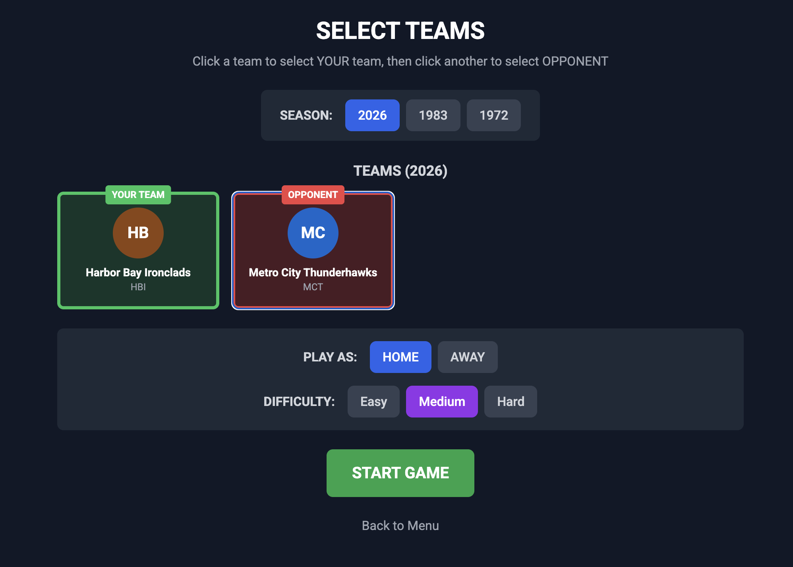
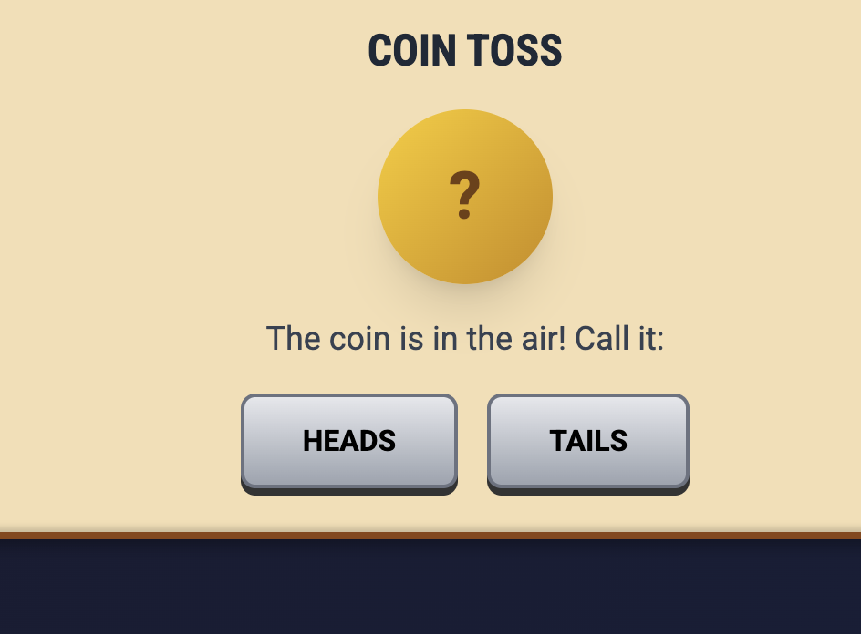
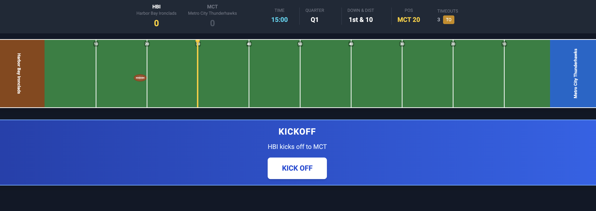
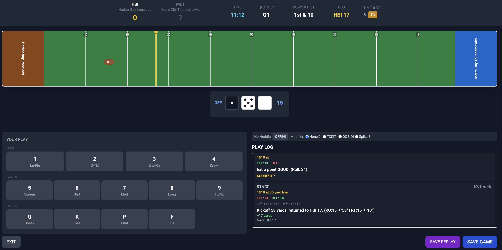
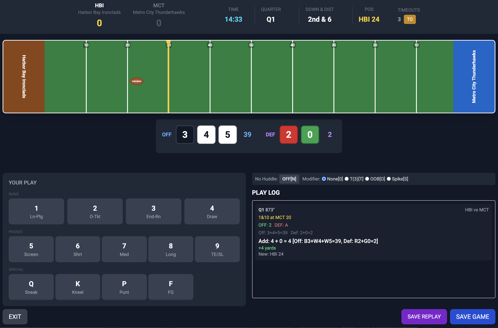

# Browser Interface

[Documentation index](README.md) · [Installation](installation.md)

The pre-built application starts a local web server and opens Paydirt in your browser.
Running frontend/backend services from source is covered in the [web development guide](../paydirt-web/README.md).

## Main Menu

Start a new game or open the User Guide. The guide's player content and screenshots are bundled for offline reading.
Links to GitHub, releases, and contributor documentation still need an internet connection.

## Starting a Browser Game

Select a season, home and away teams, which team you control, and CPU difficulty.
The public sample teams are the 2026 Thunderhawks and Ironclads; other teams require locally installed charts.

## Coin Toss

Call the coin toss and follow the receive/kick prompts. The engine handles opening and second-half possession.

## Game Screen

The scoreboard and field show the current period, score, possession, field position, down, distance, and clock.
Read the play log for outcomes, penalties, and scoring details.

## Browser Play Selection

On offense, choose a running, passing, or special play. Select any available clock modifiers before executing it.
See [clock management](clock-management.md) for what those modifiers mean.

On defense, choose a formation to counter the CPU's offense.

Resolve penalty choices when prompted. After a touchdown, choose an extra point or, when enabled by the season,
a two-point attempt. Follow kickoff and halftime prompts to continue. The final-score screen confirms game completion.

The core engine determines legal choices, timing, scoring, and results; the browser displays them.
CLI keyboard commands in [Playing](playing.md) do not describe browser shortcuts.

## Play History and Replays

Browser saved replays preserve displayed game history. They are distinct from
[CLI saved games](saved-games-and-standings.md), which resume an unfinished game,
and from proposed deterministic engine-log replay tooling.
