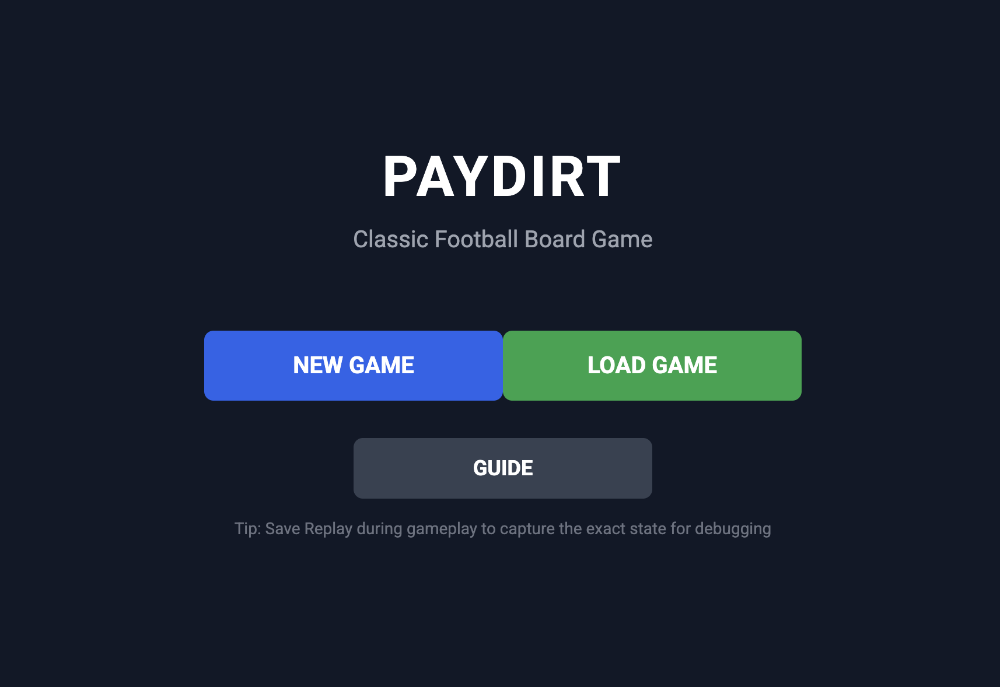
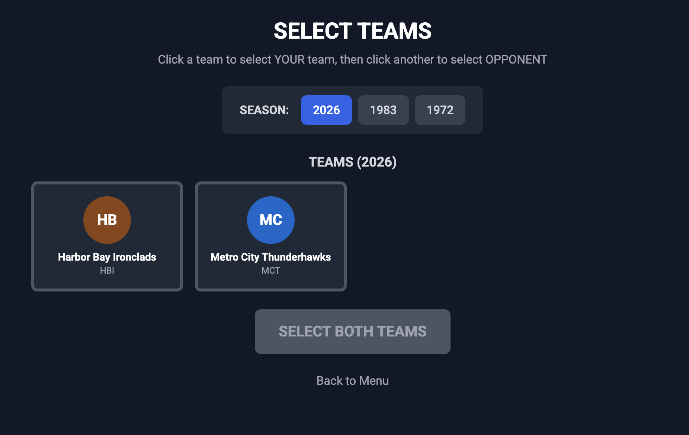
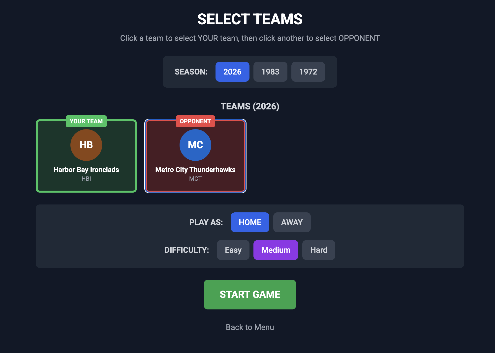
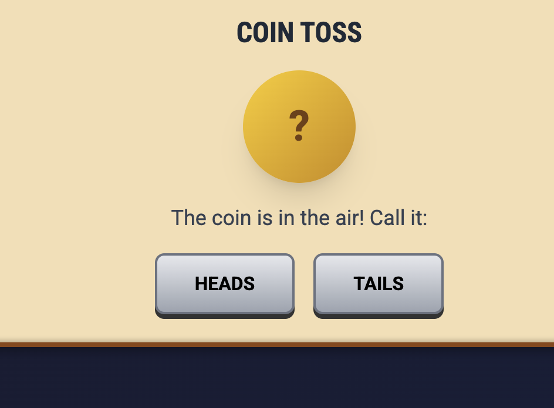
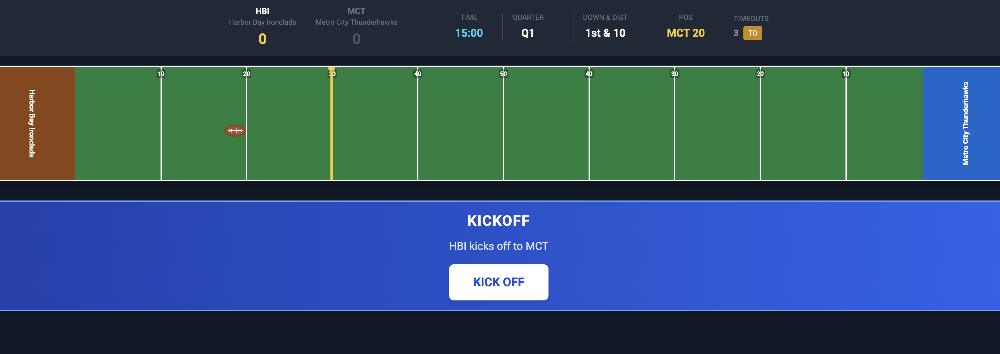
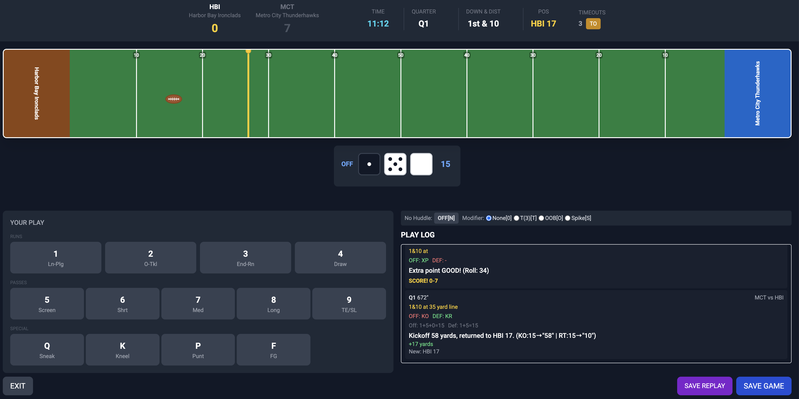
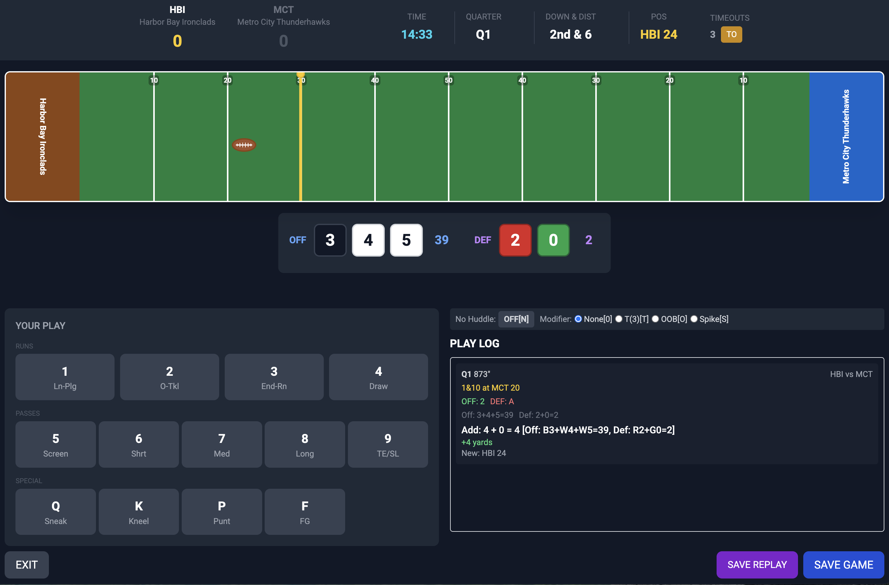

# Browser Interface

[Documentation index](README.md) · [Installation](installation.md)

The pre-built application starts a local web server and opens Paydirt in your browser.
Running frontend/backend services from source is covered in the [web development guide](../paydirt-web/README.md).

## Main Menu

Start a new game or open the User Guide. The guide's player content and screenshots are bundled for offline reading.
Links to GitHub, releases, and contributor documentation still need an internet connection.

## Starting a Browser Game

Select a season, home and away teams, which team you control, and CPU difficulty.
Published builds include generated 1983 and 2024 teams plus the fictional 2026 Thunderhawks and Ironclads. Additional teams require locally installed charts.

Choose an **End-zone interception returns** preference separately for your team
and the CPU. **Automatic touchback** is the default; **Attempt return** applies
whenever that team intercepts in its own end zone. The choice is made before
play, counts the catch's end-zone depth, and requires crossing the goal line to
avoid a touchback. It does not add an in-play prompt. Saved games retain both
preferences; older saves use automatic touchbacks.

## Coin Toss

Call the coin toss and follow the receive/kick prompts. The engine handles opening and second-half possession.

## Game Screen

The scoreboard and field show the current period, score, possession, field position, down, distance, and clock.
Each team's remaining timeouts appear as **TO: n** beneath its score, including
zero. **Call timeout** requests a timeout for your team; the opponent's count
is also visible whether you play home or away.
Read the play log for outcomes, penalties, and scoring details. Clock labels use
minutes and seconds: **Q2 0:41** means 41 seconds remaining in the second quarter.
New scrimmage-play entries show the clock at the start of the play, alongside
the starting down and field position. Older saved entries retain their recorded
clock values; their display also uses minutes and seconds.

## Browser Play Selection

On offense, choose a running, passing, or special play. Select any available clock modifiers before executing it.
See [clock management](clock-management.md) for what those modifiers mean.

On defense, choose a formation to counter the CPU's offense. To request a
timeout after that play, select **Timeout (remaining left) [T]** in the modifier panel
before choosing the formation, or press **T**. Select **None [0]** or press
**0** to cancel. The count is your team's remaining timeouts, whether you
play home or away. The engine charges one only when the result needs it;
incompletions, out-of-bounds plays and penalties already stop the clock.
The selection clears after the play is submitted, including when a penalty
decision is pending. No-huddle, out-of-bounds and spike controls apply on offense.
Hover over a modifier or the No Huddle button for its effect, cost, and shortcut.
On fourth down, wait for the CPU's decision. An early formation click waits
for that decision. If the CPU punts or attempts a field goal, use **EXECUTE PLAY**
in its decision panel; if it goes for it, choose your defensive formation.

Resolve penalty choices when prompted. Penalties on kickoff and other returns are assessed by the
engine without a prompt; the only return decision — keeping a recovered fumble or taking the
penalty against the returner — is offered to the kicking team, and the CPU keeps the recovery.
The dialog shows engine-provided previews of the retained play and available
penalties, including their resulting down, distance and field position when
the engine can project them without another roll.
After your touchdown, choose **KICK XP (1 PT)** or, when enabled by the season,
**GO FOR 2!**. The two-point button runs a Line Plunge against Standard defense
from the two-yard line. Both choices use the engine’s untimed try result;
a failed two-point attempt scores zero. The same choices apply when you play
as the home or away team, including a saved game with a pending try. Follow kickoff and halftime prompts to continue; halftime appears once the engine reports
the first half over (after any outstanding try or penalty decision), and the team that received the opening
kickoff kicks off the second half. The final-score screen confirms game completion.

The core engine determines legal choices, timing, scoring, and results; the browser displays them.
CLI keyboard commands in [Playing](playing.md) do not describe browser shortcuts.

## Team Charts

Select **CHARTS** on the game screen to open the chart reference. Choose either
team, then **Offense**, **Defense**, or **Special Teams**.
The sheets use the original Paydirt layout: numbered rushing and passing columns,
defensive formations A–F, roll rows, bold black grids, and colored result cells.
On wide desktop screens, the layout scales to show all 30 rows on one page.
**Offense** includes a compact **Special Plays** strip on its right, with the
roll rows aligned. On narrower screens the strip sits below Offense and sheets
keep scrolling so the cells remain readable. Expand **How to read the
charts** for the color and symbol legend; it starts collapsed to leave room for
the complete sheet. Printed values remain visible without relying on color.

Select **Open in new tab** or **Open in separate window** to keep the selected
team and sheet beside your game. The modal closes and you can continue playing;
the separate chart page has its own team and section controls. If the browser
blocks a separate window, use the new-tab link or allow windows for the game.
Chart links need the current backend game to remain available; after a server
restart, reopen charts from your active game.

**Special Plays** contains the breakaway (B), quarterback time (QT), and fumble
recovery columns beside Offense, with a narrow roll-number column on the right.
**Special Teams** includes kicks, returns, field goals, and extra
points. These are the charts loaded for the current game. Browsing them does not
roll dice or advance play. Close the viewer or press **Escape** to return to the game.

## Play History and Replays

**SAVE GAME** stores the current position and displayed play history in this
browser and confirms **Game saved in this browser.** The confirmation stays in
the visible window even when the controls are below the fold. If browser storage fails,
the screen reports **Could not save game in this browser.** The open game stays
available so you can retry.

Browser saved replays preserve displayed game history. They are distinct from
[CLI saved games](saved-games-and-standings.md), which resume an unfinished game,
and from proposed deterministic engine-log replay tooling.

Season and team selections, including imported replays, must refer to entries within configured season directories. Links to outside directories or assets are rejected.
