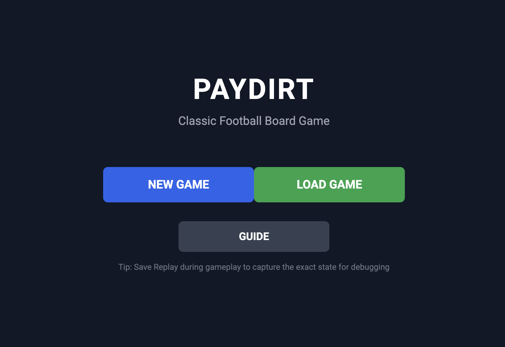
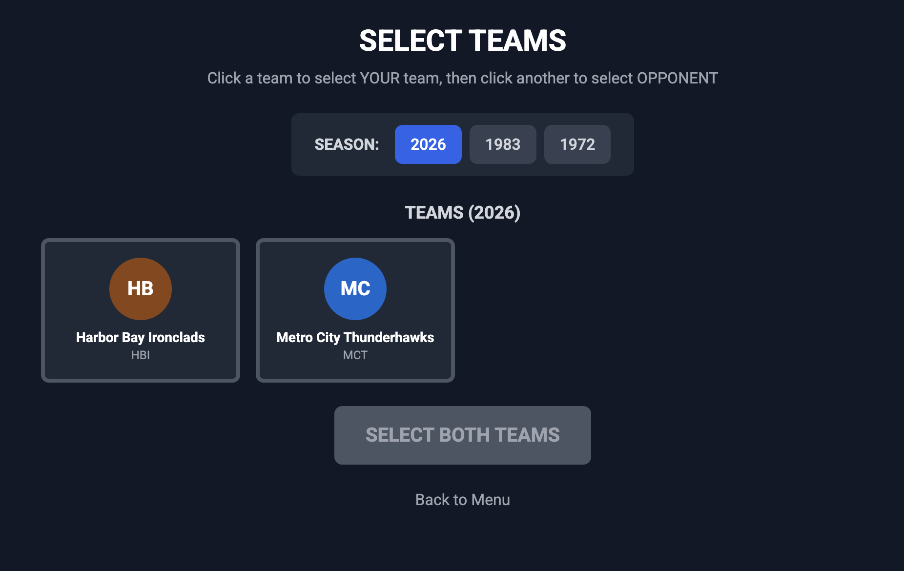
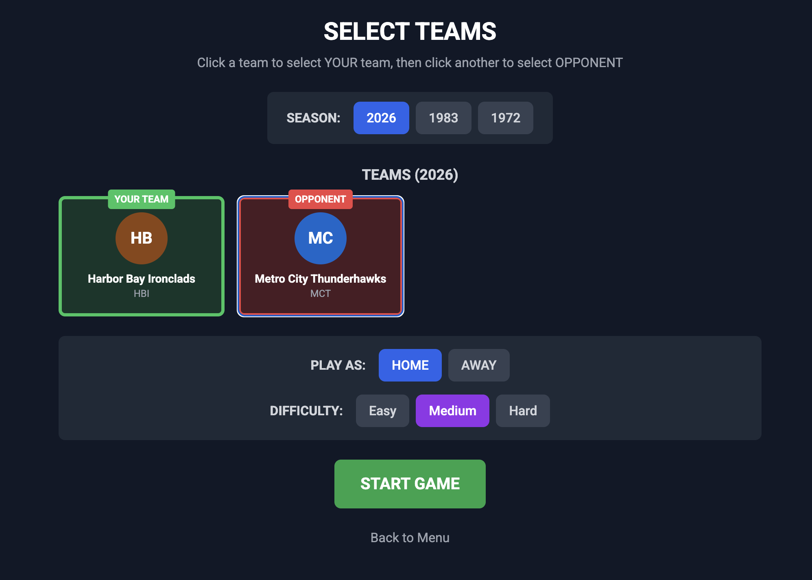
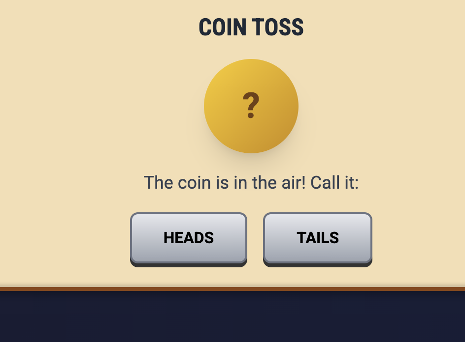
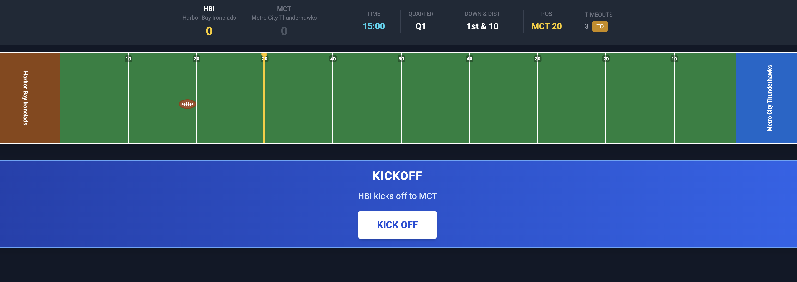
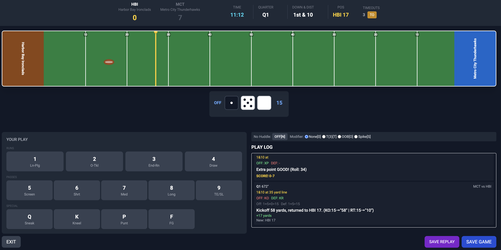
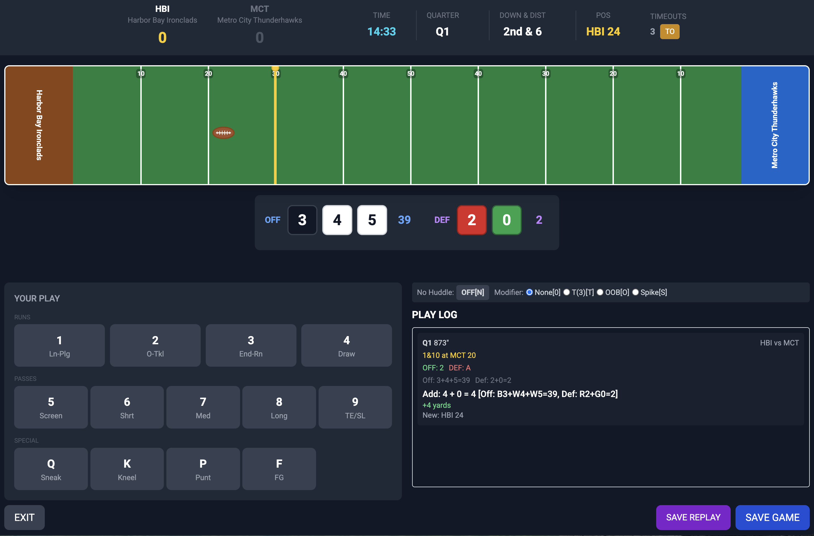

# Browser Interface

[Documentation index](README.md) · [Installation](installation.md)

The pre-built application starts a local web server and opens Paydirt in your browser.
Running frontend/backend services from source is covered in the [web development guide](../paydirt-web/README.md).

## Browser-only prototype

[Play the experimental browser build](https://rtulloh.github.io/paydirt/) using the
same game screen and Python engine, with no installed Paydirt application or
local game server. Choose from **1977 (28 teams), 1983 (28), 2024 (32)** and the
fictional **2026 sample (2)**. These are the unchanged publicly released charts;
their existing accuracy notes and attribution remain included. This is the
browser feature under development for 1.11.0.

Wait for **Loading the Python game engine…** to finish, then choose **NEW GAME**.
The first load downloads the Python runtime and packages from a public CDN and
requires an internet connection. The prototype does not support offline play.

The source build now supports durable game checkpoints and multiple season campaigns in this
browser. Use **Saved games** to resume and export a backup, and **Seasons** for schedules,
standings and team statistics. A storage failure is visible and retains the previous committed
save; retry saving instead of repeating an executed play. Offline engine loading remains unavailable.
The published experimental site can lag the source build; its own startup banner describes the
capabilities deployed there. See [saved games](saved-games-and-standings.md) for storage boundaries.

The chart viewer can open a read-only copy of both teams' charts in another tab
or window. This uses browser storage for chart data only; it does not preserve
your game. If storage is blocked, continue using the chart viewer in the game tab.

The remaining instructions describe the shared game controls. References to
installed seasons, backend sessions, saves and offline guide availability apply
to the installed application unless the prototype behavior above says otherwise.

## Main Menu

Start a new game or open the User Guide. The guide's player content and screenshots are bundled for offline reading.
Links to GitHub, releases, and contributor documentation still need an internet connection.

## Starting a Browser Game

Select each team's chart year independently, choose home and away teams, which team you
control, and CPU difficulty. Swap sides moves the complete year/team selections. Exhibitions
use the displayed home-year rules; custom campaigns use their selected fixed rules year.
Published builds include generated 1983 and 2024 teams plus the fictional 2026 Thunderhawks and Ironclads. Additional teams require locally installed charts.

End-zone interception returns are a game-time decision only. There is no pre-game
return setting. When your team intercepts in its own end zone, the engine pauses
after locating the catch and shows the engine-provided catch depth, score and
clock before any return dice are rolled. Choose **Take touchback** or **Attempt
return**; the return counts the catch's end-zone depth, and the returner must
cross the goal line to avoid a touchback. The CPU decides at the same point from
catch depth, score and clock. Saved games retain the engine's in-play state.

## Coin Toss

Call the coin toss and follow the receive/kick prompts. The engine handles opening and second-half possession.

## Game Screen

The scoreboard and field show the current period, score, possession, field position, down, distance, and clock.
Each team's remaining timeouts appear as **TO: n** beneath its score, including
zero. **Call timeout** requests a timeout for your team; the opponent's count
is also visible whether you play home or away.
Read the play log for outcomes, penalties, and scoring details. Clock labels use
minutes and seconds: **Q2 0:41** means 41 seconds remaining in the second quarter.
New scrimmage-play entries show the clock at the start of the play, alongside
the starting down and field position. Older saved entries retain their recorded
clock values; their display also uses minutes and seconds.
Team names come from possession, so the home/away labels are correct whether you
play at home or away; your team always keeps the same play-log color. Entries
written by 1.10.6 and later record the pre-play possession explicitly. Older
saved games keep their recorded teams and colors unchanged, so an interception
or lost fumble from an older save still shows the team that ran the play.

## Browser Play Selection

On offense, choose a running, passing, or special play. Select any available clock modifiers before executing it.
See [clock management](clock-management.md) for what those modifiers mean.

On defense, choose a formation to counter the CPU's offense. To request a
timeout after that play, select **Timeout (remaining left) [T]** in the modifier panel
before choosing the formation, or press **T**. Select **None [0]** or press
**0** to cancel. The count is your team's remaining timeouts, whether you
play home or away. The engine charges one only when the result needs it;
incompletions, out-of-bounds plays and penalties already stop the clock.
The selection clears after the play is submitted, including when a penalty
decision is pending. No-huddle, out-of-bounds and spike controls apply on offense.
Hover over a modifier or the No Huddle button for its effect, cost, and shortcut.
On fourth down, wait for the CPU's decision. An early formation click waits
for that decision. If the CPU punts or attempts a field goal, use **EXECUTE PLAY**
in its decision panel; if it goes for it, choose your defensive formation.

Resolve penalty choices when prompted. Penalties on kickoff and other returns are assessed by the
engine without a prompt; the only return decision — keeping a recovered fumble or taking the
penalty against the returner — is offered to the kicking team, and the CPU keeps the recovery.
The dialog shows engine-provided previews of the retained play and available
penalties, including their resulting down, distance and field position when
the engine can project them without another roll.
After your touchdown, choose **KICK XP (1 PT)** or, when enabled by the season,
**GO FOR 2!**. The two-point button runs a Line Plunge against Standard defense
from the two-yard line. Both choices use the engine’s untimed try result;
a failed two-point attempt scores zero. The same choices apply when you play
as the home or away team, including a saved game with a pending try. Follow kickoff and halftime prompts to continue; halftime appears once the engine reports
the first half over (after any outstanding try or penalty decision), and the team that received the opening
kickoff kicks off the second half. The final-score screen confirms game completion.

The core engine determines legal choices, timing, scoring, and results; the browser displays them.
CLI keyboard commands in [Playing](playing.md) do not describe browser shortcuts.

## Team Charts

Select **CHARTS** on the game screen to open the chart reference. Choose either
team, then **Offense**, **Defense**, or **Special Teams**.
The sheets use the original Paydirt layout: numbered rushing and passing columns,
defensive formations A–F, roll rows, bold black grids, and colored result cells.
On wide desktop screens, the layout scales to show all 30 rows on one page.
**Offense** includes a compact **Special Plays** strip on its right, with the
roll rows aligned. On narrower screens the strip sits below Offense and sheets
keep scrolling so the cells remain readable. Expand **How to read the
charts** for the color and symbol legend; it starts collapsed to leave room for
the complete sheet. Printed values remain visible without relying on color.

Select **Open in new tab** or **Open in separate window** to keep the selected
team and sheet beside your game. The modal closes and you can continue playing;
the separate chart page has its own team and section controls. If the browser
blocks a separate window, use the new-tab link or allow windows for the game.
Chart links need the current backend game to remain available; after a server
restart, reopen charts from your active game.

**Special Plays** contains the breakaway (B), quarterback time (QT), and fumble
recovery columns beside Offense, with a narrow roll-number column on the right.
**Special Teams** includes kicks, returns, field goals, and extra
points. These are the charts loaded for the current game. Browsing them does not
roll dice or advance play. Close the viewer or press **Escape** to return to the game.

## Play History and Replays

**SAVE GAME** writes a complete engine checkpoint and confirms **Game saved locally.**
Actions also autosave. Open **Saved games** from the main menu to resume, rename, export, import,
or delete a named game. Both teams retain their independent chart years. A restored game resumes
its recorded phase and procedures rather than guessing from the displayed play history.
The checkpoint retains the authoritative play log, including resolved decisions and dice.

Legacy **SAVE REPLAY** retains the older displayed-history/debugging workflow where available;
it is separate from full engine checkpoints, [CLI saves](saved-games-and-standings.md), and
proposed deterministic engine-log replay tooling. Use the new checkpoint flow for reliable continuation.

Season and team selections, including imported replays, must refer to entries within configured season directories. Links to outside directories or assets are rejected.
